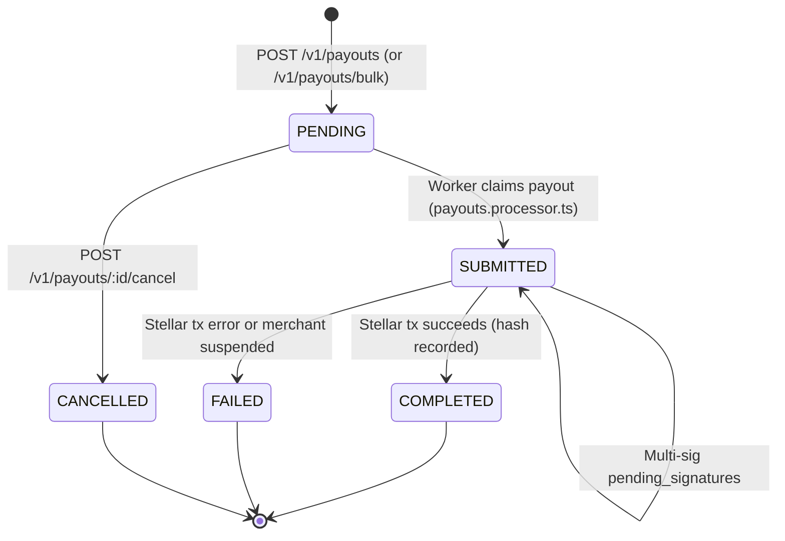

# Outbound Payouts (`docs/PAYOUTS.md`)

FacilPay enables merchants to send outbound Stellar payouts directly from their available balance to third-party Stellar accounts (`G...` public keys). Payouts are validated synchronously against recipient account requirements, available merchant balance, and daily currency limits before being queued for asynchronous on-chain submission via BullMQ.

---

## Table of Contents

1. [Payout State Machine](#payout-state-machine)
2. [Asynchronous Processing & Stellar Submission](#asynchronous-processing--stellar-submission)
3. [Balance Calculation & Reservation](#balance-calculation--reservation)
4. [Amount Precision Rules (`payout-amount.util.ts`)](#amount-precision-rules-payout-amountutilts)
5. [API Endpoints](#api-endpoints)
   - [`POST /v1/payouts` — Create a Payout](#post-v1payouts--create-a-payout)
   - [`POST /v1/payouts/bulk` — Bulk CSV Payout Upload](#post-v1payoutsbulk--bulk-csv-payout-upload)
   - [`POST /v1/payouts/:id/cancel` — Cancel a Pending Payout](#post-v1payoutsidcancel--cancel-a-pending-payout)
   - [`GET /v1/payouts` — List Payouts](#get-v1payouts--list-payouts)
   - [`GET /v1/payouts/balance` — Get Available Payout Balance](#get-v1payoutsbalance--get-available-payout-balance)
   - [`GET /v1/payouts/:id` — Get Payout Details](#get-v1payoutsid--get-payout-details)
   - [`PATCH /v1/admin/payouts/limits` (`PATCH /v1/payouts/limits`) — Configure Daily Payout Limits](#patch-v1adminpayoutslimits-patch-v1payoutslimits--configure-daily-payout-limits)
6. [Webhook & Realtime Events](#webhook--realtime-events)
7. [Common Failure Reasons & Troubleshooting](#common-failure-reasons--troubleshooting)

---

## Payout State Machine

Every payout record (`Payout` entity in `src/modules/payouts/entities/payout.entity.ts`) moves through a well-defined state machine (`PayoutStatus`):



### Status Definitions

| Status | Terminal? | Reserves Balance & Daily Limit? | Description |
| :--- | :---: | :---: | :--- |
| `PENDING` | No | **Yes** | Accepted, validated, persisted in PostgreSQL, and queued in BullMQ (`payouts` queue). Can still be cancelled by the merchant. |
| `SUBMITTED` | No | **Yes** | Claimed by `PayoutsProcessor` (`submittedAt` timestamp set) and transmitted to Stellar (or awaiting additional platform multi-sig signers). Cannot be cancelled. |
| `COMPLETED` | Yes | **Yes** | Confirmed on the Stellar network. `transactionHash` and `completedAt` are recorded. |
| `FAILED` | Yes | **No** | On-chain submission failed (or merchant became inactive prior to broadcast). `failureReason` and `failedAt` are recorded, and the reserved amount is automatically returned to the merchant's available balance. |
| `CANCELLED` | Yes | **No** | Cancelled by the merchant while still `PENDING`. Releases the reserved balance and daily limit quota immediately. |

> **Active Payout Statuses (`ACTIVE_PAYOUT_STATUSES`):**
> Only `PENDING`, `SUBMITTED`, and `COMPLETED` payouts count against a merchant's `paidOut` total and daily payout limit. Once a payout transitions to `FAILED` or `CANCELLED`, its amount is automatically excluded from balance reservation and daily limit calculations.

---

## Asynchronous Processing & Stellar Submission

Outbound payouts are processed asynchronously by `PayoutsProcessor` (`src/modules/payouts/payouts.processor.ts`) and `PayoutsService.process()` (`src/modules/payouts/payouts.service.ts`):

1. **Synchronous Pre-Check & Queueing:**
   - When `POST /v1/payouts` is called, `PayoutsService.create()` first verifies the `X-Step-Up-Token`, checks that the merchant account is active, validates the Stellar destination via Horizon (`stellarService.validatePayoutRecipient`), acquires a per-merchant, per-currency transaction-scoped advisory lock (`pg_advisory_xact_lock(hashtext('payout:<merchantId>:<currency>'))`), verifies reference uniqueness, checks available balance and UTC daily limit, and inserts the `Payout` in `PENDING` status.
   - A BullMQ job (`process`) is added to the `payouts` queue with `jobId = payout.id` and **`attempts: 1`**. Automatic retries are intentionally disabled so an ambiguous network timeout never submits a duplicate on-chain payment.
2. **Atomic Worker Claim:**
   - `PayoutsProcessor.process(job)` invokes `payoutsService.process(payoutId)`.
   - The service performs an atomic conditional update:
     ```sql
     UPDATE payouts
        SET status = 'SUBMITTED', "submittedAt" = NOW()
      WHERE id = $1 AND status = 'PENDING';
     ```
   - If `affected === 0` (for example, the payout was cancelled right before the worker picked up the job, or was already claimed), the worker logs a warning and exits safely without touching the network.
3. **Stellar Network Broadcast:**
   - Emits `payout.submitted`.
   - Re-verifies `usersService.assertMerchantActive(payout.merchantId)`.
   - Calls `stellarService.sendPayout({ destination, amount, assetCode, memo, merchantId })`.
   - **Multi-signature support:** If the payout exceeds the single-signer threshold and `sendPayout` returns `{ status: 'pending_signatures', multiSigTransactionId }`, the payout remains in `SUBMITTED` status while awaiting co-signers.
   - **Success:** When `result.hash` is returned, the payout transitions to `COMPLETED`, stores `transactionHash` and `completedAt`, and emits `payout.completed`.
   - **Failure:** Any thrown error (or missing transaction hash) transitions the payout to `FAILED`, stores `failureReason` and `failedAt`, emits `payout.failed`, and releases the reserved balance back to the merchant.

---

## Balance Calculation & Reservation

`GET /v1/payouts/balance?currency=USDC` computes the real-time payout balance for a given asset code using integer unit math (`toUnits` / `fromUnits`):

$$\text{available} = \max\left(0,\; \text{credited} - \text{settled} - \text{paidOut}\right)$$

Where:
- **`credited`**: Sum of `netAmount - refundedAmount` across all merchant payments in `COMPLETED`, `PARTIALLY_REFUNDED`, or `REFUNDED` status for that currency.
- **`settled`**: Sum of `totalAmount` across all `COMPLETED` settlements for that merchant and currency (including held reserves).
- **`paidOut`**: Sum of `amount` across all payouts in `ACTIVE_PAYOUT_STATUSES` (`PENDING`, `SUBMITTED`, `COMPLETED`) for that merchant and currency.

---

## Amount Precision Rules (`payout-amount.util.ts`)

Stellar assets use **7 decimal places** of precision, where the smallest indivisible unit is a **stroop** ($10^{-7}$ of a unit, or `SCALE = 7`, `FACTOR = 10_000_000n`).

`src/modules/payouts/payout-amount.util.ts` provides two deterministic helpers that avoid IEEE-754 floating-point rounding errors by operating exclusively on `bigint` stroop values:

- **`toUnits(value: string | number | null | undefined): bigint`**
  - Parses a decimal string or number into integer stroops (`bigint`).
  - Treats `null`, `undefined`, or `""` as `0n`.
  - Accepts up to 7 significant fractional digits (e.g. `"125.5"` $\rightarrow$ `1255000000n`).
  - Trailing zeroes beyond 7 decimal places (e.g. `"1.123456700"`) are permitted, but **any non-zero digit beyond 7 decimal places throws `Error("Amount has more than 7 decimal places: ...")`**.
  - Rejects scientific notation or malformed strings with `Error("Invalid decimal amount: ...")`.
- **`fromUnits(units: bigint): string`**
  - Formats a `bigint` stroop count back into a canonical 7-decimal string (e.g. `1255000000n` $\rightarrow$ `"125.5000000"`).

At the API boundary, `CreatePayoutDto` enforces:
- Positive non-zero decimal string matching `/^(?!0+(\.0+)?$)\d{1,13}(\.\d{1,7})?$/` (up to 13 integer digits and 1–7 fractional digits).

---

## API Endpoints

All `/v1/payouts` endpoints require a valid JWT bearer token (`Authorization: Bearer <token>`).

### `POST /v1/payouts` — Create a Payout

Creates and queues a new outbound payout to a Stellar public key.

- **Permissions:** `payouts:create`
- **Headers:** `X-Step-Up-Token: <token>` (obtained from `POST /v1/auth/step-up`)

#### Request Body (`CreatePayoutDto`)

```json
{
  "destination": "GBRPYHIL2CI3FNQ4BXLFMNDLFJUNPU2HY3ZMFSHONUCEOASW7QC7OX2H",
  "amount": "125.50",
  "currency": "USDC",
  "memo": "INV-2026-0042",
  "reference": "supplier-invoice-0042"
}
```

| Field | Type | Required | Constraints |
| :--- | :--- | :---: | :--- |
| `destination` | `string` | Yes | Valid Stellar public key (`^G[A-Z2-7]{55}$`). |
| `amount` | `string` | Yes | Positive decimal string with 1–7 decimal places. |
| `currency` | `string` | Yes | Stellar asset code (`^[A-Z0-9]{1,12}$`, auto-uppercased). |
| `memo` | `string` | Conditional | Optional UTF-8 text memo (max 28 bytes). **Required** if the destination account sets `config.memo_required` on Stellar. |
| `reference` | `string` | Yes | Idempotency/reconciliation reference (`1..100` chars), unique per merchant. |

#### Response (`201 Created`)

```json
{
  "id": "b6d9c1f0-3c4b-4e8e-9a1b-8c7e6d5f4a3b",
  "batchId": null,
  "merchantId": "7f3c2a10-1111-4222-8333-999988887777",
  "destination": "GBRPYHIL2CI3FNQ4BXLFMNDLFJUNPU2HY3ZMFSHONUCEOASW7QC7OX2H",
  "amount": "125.5000000",
  "currency": "USDC",
  "memo": "INV-2026-0042",
  "reference": "supplier-invoice-0042",
  "status": "PENDING",
  "transactionHash": null,
  "failureReason": null,
  "submittedAt": null,
  "completedAt": null,
  "failedAt": null,
  "createdAt": "2026-11-10T12:00:00.000Z",
  "updatedAt": "2026-11-10T12:00:00.000Z"
}
```

---

### `POST /v1/payouts/bulk` — Bulk CSV Payout Upload

Uploads a CSV file of payouts (`multipart/form-data`, field name `file`, max 1 MiB / 1,000 rows).

- **Permissions:** `payouts:create`
- **Headers:** `X-Step-Up-Token: <token>`
- **CSV Columns:** `destination,amount,currency,reference[,memo]`
- Validates all recipients, references, per-currency available balances, and daily limits atomically before persisting any rows.

#### Response (`201 Created`)

```json
{
  "batchId": "2d8e4b10-7777-4888-9999-111122223333",
  "rows": [
    {
      "row": 2,
      "payoutId": "b6d9c1f0-3c4b-4e8e-9a1b-8c7e6d5f4a3b",
      "reference": "supplier-invoice-0042",
      "status": "PENDING"
    }
  ]
}
```

---

### `POST /v1/payouts/:id/cancel` — Cancel a Pending Payout

Cancels a payout that is still in `PENDING` status and releases its reserved balance and daily limit.

- **Permissions:** `payouts:create`
- **Idempotency:** Calling cancel on an already-`CANCELLED` payout returns `200 OK` with the payout.
- **Conflict (`409 Conflict`):** Returned if the payout is already `SUBMITTED`, `COMPLETED`, or `FAILED`.

---

### `GET /v1/payouts` — List Payouts

Returns a paginated list of payouts for the authenticated merchant, ordered by `createdAt DESC`.

#### Query Parameters (`ListPayoutsDto`)

| Parameter | Type | Default | Description |
| :--- | :--- | :---: | :--- |
| `page` | `number` | `1` | Page number ($\ge 1$). |
| `limit` | `number` | `20` | Page size ($1 \le \text{limit} \le 100$). |
| `status` | `PayoutStatus` | — | Filter by `PENDING`, `SUBMITTED`, `COMPLETED`, `FAILED`, or `CANCELLED`. |
| `currency` | `string` | — | Filter by asset code (e.g. `USDC`). |

#### Example Request & Response (`200 OK`)

```bash
curl -X GET "http://localhost:3000/v1/payouts?currency=USDC&status=COMPLETED&page=1&limit=20" \
  -H "Authorization: Bearer <JWT>"
```

```json
{
  "data": [
    {
      "id": "b6d9c1f0-3c4b-4e8e-9a1b-8c7e6d5f4a3b",
      "batchId": null,
      "merchantId": "7f3c2a10-1111-4222-8333-999988887777",
      "destination": "GBRPYHIL2CI3FNQ4BXLFMNDLFJUNPU2HY3ZMFSHONUCEOASW7QC7OX2H",
      "amount": "125.5000000",
      "currency": "USDC",
      "memo": "INV-2026-0042",
      "reference": "supplier-invoice-0042",
      "status": "COMPLETED",
      "transactionHash": "8f4e2d1c9b8a7f6e5d4c3b2a190807060504030201f0e0d0c0b0a09080706050",
      "failureReason": null,
      "submittedAt": "2026-11-10T12:00:01.000Z",
      "completedAt": "2026-11-10T12:00:05.000Z",
      "failedAt": null,
      "createdAt": "2026-11-10T12:00:00.000Z",
      "updatedAt": "2026-11-10T12:00:05.000Z"
    }
  ],
  "total": 1,
  "page": 1,
  "limit": 20
}
```

---

### `GET /v1/payouts/balance` — Get Available Payout Balance

Returns the merchant's credited, settled, paid out, and remaining available payout balance for a single currency.

#### Query Parameters (`PayoutBalanceQueryDto`)

| Parameter | Type | Required | Description |
| :--- | :--- | :---: | :--- |
| `currency` | `string` | Yes | Asset code to query (e.g. `USDC`). |

#### Example Request & Response (`200 OK`)

```bash
curl -X GET "http://localhost:3000/v1/payouts/balance?currency=USDC" \
  -H "Authorization: Bearer <JWT>"
```

```json
{
  "currency": "USDC",
  "available": "874.5000000",
  "credited": "1500.0000000",
  "settled": "500.0000000",
  "paidOut": "125.5000000"
}
```

---

### `GET /v1/payouts/:id` — Get Payout Details

Fetches a single payout by UUID for the authenticated merchant. Returns `404 Not Found` if the ID does not exist or belongs to another merchant.

---

### `PATCH /v1/admin/payouts/limits` (`PATCH /v1/payouts/limits`) — Configure Daily Payout Limits

By default, every merchant is subject to the platform-wide daily payout limit configured via the `PAYOUT_DAILY_LIMIT` environment variable (default: `10000` units per currency per UTC day, measured from `00:00:00 UTC`).

Platform administrators (`UserRole.ADMIN`) can override or reset a merchant's daily limit for a specific currency using `PATCH /v1/admin/payouts/limits` (`AdminPayoutsController.setLimit` in `src/modules/payouts/payouts.controller.ts`):

#### Request Body (`SetPayoutLimitDto`)

```json
{
  "merchantId": "7f3c2a10-1111-4222-8333-999988887777",
  "currency": "USDC",
  "dailyLimit": "25000.0000000"
}
```

- Pass `"dailyLimit": null` to delete the per-merchant override and revert to `PAYOUT_DAILY_LIMIT`.

#### Response (`200 OK`)

```json
{
  "merchantId": "7f3c2a10-1111-4222-8333-999988887777",
  "currency": "USDC",
  "dailyLimit": "25000.0000000"
}
```

---

## Webhook & Realtime Events

Every state transition emits both an internal EventBus/SSE event and a signed merchant webhook delivery:

| Event Name | Triggered When |
| :--- | :--- |
| `payout.created` | Payout is accepted and queued in `PENDING` status. |
| `payout.submitted` | Worker transitions the payout from `PENDING` to `SUBMITTED`. |
| `payout.completed` | Stellar transaction succeeds; `transactionHash` is populated. |
| `payout.failed` | Stellar transaction fails; `failureReason` is populated and balance is released. |
| `payout.cancelled` | Merchant cancels a `PENDING` payout via `POST /v1/payouts/:id/cancel`. |

---

## Common Failure Reasons & Troubleshooting

Payouts can fail either synchronously during `POST /v1/payouts` validation (`4xx` HTTP response) or asynchronously during background Stellar submission (`status = FAILED` with `failureReason`):

| Stage | Error / Failure Reason | Cause & Resolution |
| :--- | :--- | :--- |
| **Synchronous (`401`)** | `Missing or invalid step-up token` | Obtain a fresh step-up token from `POST /v1/auth/step-up` and pass it in the `X-Step-Up-Token` header. |
| **Synchronous (`400`)** | `memo must be at most 28 bytes` | Stellar text memos are capped at 28 UTF-8 bytes. Shorten the memo string (note that multi-byte UTF-8 characters count as multiple bytes). |
| **Synchronous (`400`)** | Destination account does not exist on Stellar | The `G...` recipient address has not been funded/activated on the Stellar network. |
| **Synchronous (`400`)** | Destination does not trust asset `<currency>` | The recipient account has not established a Stellar trustline for the non-native asset (or its trustline is unauthorized/full). |
| **Synchronous (`400`)** | Destination requires a memo (`config.memo_required`) | Exchanges and custodial wallets often set `config.memo_required=1` in Stellar account data. Supply the customer's deposit `memo`. |
| **Synchronous (`400`)** | `Insufficient available balance: <X> <currency> available` | Requested amount exceeds `credited - settled - paidOut`. Check `GET /v1/payouts/balance`. |
| **Synchronous (`400`)** | `Daily payout limit of <limit> <currency> would be exceeded` | Active payouts created since `00:00:00 UTC` plus the new payout exceed the merchant's daily limit. Wait until the next UTC day or request a limit increase via an administrator. |
| **Synchronous (`409`)** | `A payout with reference "<ref>" already exists` | `reference` is unique per merchant. Use `GET /v1/payouts` to inspect the existing payout for that reference before creating a new one with a distinct reference if the previous attempt failed/cancelled. |
| **Asynchronous (`FAILED`)** | `tx_bad_seq` / `op_underfunded` / Horizon error | The platform Stellar hot wallet encountered an on-chain error or sequence mismatch, or the recipient removed their trustline after creation. The merchant's available balance is automatically restored. |
| **Asynchronous (`FAILED`)** | `Stellar submission returned no transaction hash` | Horizon response did not include a confirmed transaction hash. |
| **Asynchronous (`FAILED`)** | Merchant account suspended/closed | `assertMerchantActive` failed when the worker attempted to process the queued job. |
